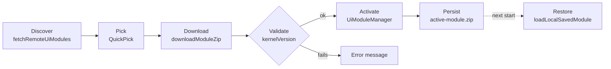

# How Modules Work in Catalyst UI

_As of 2026-10-31: catalyst 0.120.0, software-engineering module 3.4.1, knowledge-base module 0.6.1, catalyst UI 0.70.0._

A process module is a versioned zip bundle for one process domain, built from its own
`catalyst-<module-id>` repository. catalyst installs and runs modules; a criterion may hold more than one (the
knowledge-base module installs alone or beside any other, with `catalyst module install`). The catalyst UI VS Code
extension finds a module's bundle on cantica-tech, checks it against the **kernel** version, activates it as its UI
module, and keeps a local copy. Only one UI module is active in the extension at a time.

The views themselves never read a module: since catalyst UI 0.39.0 every project is read through `catalyst serve`, and
since 0.43.0 the chain tree, the Studio and the app model follow the types catalyst's `graph` reports, so no UI package
names a module type.

## Terms

| Term           | Meaning                                                                                                                                                                                                                                                 |
| -------------- | ------------------------------------------------------------------------------------------------------------------------------------------------------------------------------------------------------------------------------------------------------- |
| Framework      | The whole of catalyst: the kernel plus its process modules.                                                                                                                                                                                             |
| Kernel         | The part of the framework independent of modules, in `framework/kernel/` in the catalyst repo. Versioned by catalyst's root `version.txt`. Released as `kernel-v<version>.zip` with the CLI as `catalyst.pyz`.                                          |
| Process module | Entity types, templates, slash commands and a grounding type, declared in `module.yaml` (format 3: the entity types inline under `entities:`; `framework/kernel/MODULE-SPECIFICATION.md`). Read by catalyst (`scripts/module_loader.py`) and by agents. |
| UI module      | The same bundle zipped with a `manifest.json`, plus React components under `ui/` where the module has them. Used by the extension (`catalyst-core/src/ui-module-manager.ts`, `remote-module-store.ts`).                                                 |

## Where modules live

Each module is a full repository of its own, checked out **next to** catalyst. None is a catalyst submodule
(`framework/modules/software-engineering` was removed in catalyst 0.35.0); catalyst's
`framework/modules/catalog.md` lists them.

```
sources/
├── catalyst/                          # framework/kernel/, framework/modules/{catalog.md, sample-process}
├── catalyst-software-engineering/     # the software-engineering module (origin: catalyst-software-engineering.git)
├── catalyst-knowledge-base/           # the knowledge-base module (origin: catalyst-knowledge-base.git)
├── catalyst-ui/                       # the extension; software-engineering's ui/ builds against it
└── cantica-tech/                      # the public distribution repository: published releases
```

The sibling layout is load-bearing:

| Consumer                                                               | Where it looks                                                                                                                                                                                                           |
| ---------------------------------------------------------------------- | ------------------------------------------------------------------------------------------------------------------------------------------------------------------------------------------------------------------------ |
| `task release` / `task release:publish` (`scripts/package_release.py`) | `../catalyst-<id>/` for each module in `framework/modules/catalog.md`; skips any that is not checked out                                                                                                                 |
| `scripts/module_loader.py`                                             | the criterion's `modules/<id>`, then the project's `.criterion/modules/<id>`, `framework/modules/<id>` and `../catalyst-<id>/`, then catalyst's own `framework/modules/<id>` and `../catalyst-<id>/`; no built-in module |
| software-engineering's `ui/tsconfig.json`                              | `../../catalyst-ui/` for `catalyst-core` types (built `dist/index.d.ts`), `react` and `marked`                                                                                                                           |

catalyst's `.vscode/catalyst.code-workspace` opens these folders together, with the other catalyst-governed
repositories.

## Anatomy of a module repo

```
catalyst-software-engineering/
├── module.yaml                 # manifest (format 3): entities (BUG, REQ, HK, TEST, STEP, FEAT, ADR, RM), commands,
│                               #   templates, definitions, required_paths, contributions, kernel_version (>=0.83.0)
├── version.txt                 # module version (3.4.1), read by the release task
├── templates/                  # roadmap and index templates (roadmap, requirements, features, backlog)
├── definitions/backlog/        # DEFINITION-BACKLOG-v1.md, -v2.md
├── rules-of-rules.module.md    # module meta-rules, appended to the deployed Rules-of-Rules
├── code-of-conduct.module.md   # module document types and commands (CODE-OF-CONDUCT §3/§4)
├── INVARIANTS.module.md        # module law and invariants
├── Taskfile.module.yml         # one dispatch task per module command
├── migrations/                 # module migrations + migrations.md
├── ui/                         # npm package @catalyst-modules/software-engineering-ui
│   ├── index.ts                # exports Backlog, RoadmapDetails
│   ├── Backlog.tsx
│   ├── RoadmapDetails.tsx
│   └── tsconfig.json           # outDir dist/
└── catalyst/modules/software-engineering/v<version>/   # release output, committed
    ├── manifest.json
    └── software-engineering-v<version>.zip
```

`catalyst-knowledge-base` has the same shape without `ui/`, `templates/`, `definitions/` or `Taskfile.module.yml`:
its `module.yaml` declares the entities KB, KSOURCE and KBUILD, the `kb-*` commands and `kernel_version: ">=0.107.0"`,
and its releases land in `catalyst/modules/knowledge-base/` (an earlier module, `cantica-knowledge-base/` v0.1.0, stays beside it).

### The UI manifest (`manifest.json`)

The extension reads only this file. `parseUiModuleFromZip` checks the required
fields.

| Field              | Required | Example                               | Meaning                                                                                                                                                                                                        |
| ------------------ | -------- | ------------------------------------- | -------------------------------------------------------------------------------------------------------------------------------------------------------------------------------------------------------------- |
| `id`               | Yes      | `software-engineering`                | Unique id; also the folder name on cantica-tech                                                                                                                                                                |
| `name`             | Yes      | `Software Engineering Process Module` | Label in the module picker                                                                                                                                                                                     |
| `version`          | Yes      | `3.4.1`                               | Module version; release folder is `v<version>`                                                                                                                                                                 |
| `kernelVersion`    | Yes      | `>=0.83.0`                            | UV-style specifier the active kernel must satisfy: the module's own `kernel_version` from `module.yaml`.                                                                                                       |
| `frameworkVersion` | Legacy   | `>=0.83.0`                            | Old name of `kernelVersion`, written with the same value. Extension builds before 0.31.0 read only this field. catalyst UI 0.31.0+ prefers `kernelVersion` and falls back to it (`readManifestKernelVersion`). |
| `description`      | No       |                                       | Picker detail line                                                                                                                                                                                             |
| `entry`            | No       | `ui/index.js`                         | Entry script for the UI code (declared, not executed yet)                                                                                                                                                      |
| `components`       | No       |                                       | Reserved                                                                                                                                                                                                       |

The loader looks for `manifest.json`, then `ui-module.json`, then `module.json`,
first at the zip root and then in any subfolder.

## Lifecycle in the extension



This is the "Catalyst: Switch Process UI Module…" path. "Load Zipped UI
Module…" skips discovery and download.

1. **Discover.** `fetchRemoteUiModules(catalyst.moduleSourceUrl)` defaults to
   `git@github.com:cantica-tech/cantica-tech.git/catalyst/`.
   `parseArtifactSourceLocation` accepts a Git SSH URL with a path, a GitHub
   tree URL, a `git+https://…#branch:path` URI, a raw.githubusercontent URL, or
   a local path. It derives `moduleSubpath` (`catalyst/modules`) and
   `kernelSubpath` (`catalyst/kernel`; a legacy `…/framework` path maps to
   `…/kernel`). It tries three strategies and stops at the first that finds
   modules:
   1. Local folder scan, for `/path` or `file://` sources.
   2. Git CLI: a shallow clone cached in `<os tmp>/catalyst-git-remotes/<sha256(url)[:12]>`, then a scan. Works for private repos over SSH.
   3. GitHub REST API: the recursive tree plus raw manifest fetches. For public repos when `git` is missing.

   A scan expects `<modules>/<id>/v<version>/manifest.json` next to a zip,
   preferring `<id>-v<version>.zip`. Manifests without `id`, `version` and a
   kernel specifier are ignored; duplicate `id@version` pairs are dropped.

2. **Pick and download.** One QuickPick row per module; `downloadModuleZip`
   reads local paths and fetches `http` URLs.
3. **Validate and activate.** `UiModuleManager.loadAndActivateZipModule(zip,
kernelVersion)` unzips in memory, checks the manifest, and tests the
   specifier with `satisfiesUvVersionSpecifier` (`>=`, `<=`, `>`, `<`, `==`,
   `!=`, `~=`, `*`, comma-separated clauses combined with AND). On success it
   deactivates the current module and stores the new one, all files included.
   The kernel version checked is, in order: the one set with "Load Specific
   Kernel Version in Memory…", else the first deployment's criterion
   `version.txt`, else `REQUIRED_KERNEL_VERSION` (`>=0.54.0`).
4. **Persist and restore.** The zip is saved as
   `<globalStorageUri>/active-module.zip` (one slot) and restored at startup,
   checked against the first deployment's kernel version, else the floor
   (`KERNEL_VERSION_FLOOR`, 0.54.0; `restoreKernelVersion`). If a workspace
   folder has no catalyst project file and no module is active, the picker
   opens automatically.

## Integration contract with catalyst UI

A module plugs in through its manifest, the kernel-version check, and the
host's commands and settings. Its UI code is shipped and held in memory, but
catalyst UI does not run it yet.

| Kind    | Id                             | What it does                                                                                   |
| ------- | ------------------------------ | ---------------------------------------------------------------------------------------------- |
| Command | `catalyst.switchUiModule`      | Discover, pick, download, activate, persist                                                    |
| Command | `catalyst.loadUiModule`        | Activate a local `.zip`, persist it, refresh the tree and panels                               |
| Command | `catalyst.selectKernelVersion` | Set the in-memory kernel version and activate a placeholder `software-engineering-ui` manifest |
| Setting | `catalyst.moduleSourceUrl`     | Where modules are listed (default `cantica-tech.git/catalyst/`)                                |
| Setting | `catalyst.kernelSourceUrl`     | Where kernel releases are listed (default `cantica-tech.git/catalyst/kernel/`)                 |

On catalyst's side, a project's `catalyst.toml` names its module (`module = "…"`), and `catalyst module install` adds
another beside it in the criterion. catalyst-core no longer reads `module.yaml` itself: the types, states and
sections the views show come from `catalyst graph` (catalyst UI 0.43.0), and the commands, roles and definitions from
catalyst too (0.53.0). The kernel names no module (since catalyst 0.36.0): reconciliation (`RECON-`) and workflows
(`WORKFLOW-`) are kernel entities, and everything else comes from the modules (MODULE-SPECIFICATION §6).

**Rendering.** A compile-time link (the module's `ui/` as an npm workspace of
catalyst UI, `eff7eb8`) was tried and reverted in `0616dbc`. It tied catalyst
UI's build to one module and ruled out switching at runtime. `Backlog` therefore exists twice: live in
`packages/catalyst-ui/src`, and shipped but not rendered in software-engineering's `ui/`; `RoadmapDetails` lives only
in the module's `ui/` (the Studio's Roadmap view shows roadmaps). The missing piece is a runtime hook in the webview
that loads `manifest.entry` from `ActiveUiModule.files`.

## Build, packaging and release

`task release` in catalyst runs `scripts/package_release.py`; `task release:publish PUBLISH_DIR=<cantica-tech
checkout>` adds `--publish-dir` and `--push`. Nothing is committed or pushed without `--push`.

1. **Modules.** For each module in catalyst's `framework/modules/catalog.md`
   checked out as `../catalyst-<id>/`, it writes
   `manifest.json` (`kernelVersion` and legacy `frameworkVersion`, both the module's `kernel_version` from
   `module.yaml`, or `">=<kernel version>"` with a warning when it declares none, and `entry: "ui/index.js"`) and
   zips the repo into `catalyst/modules/<id>/v<version>/`. It skips dotfiles,
   `node_modules`, `dist` and `catalyst/`. With `--push` it commits the release onto the module repo's `origin main`
   through a temporary worktree, and pushes it.
2. **Kernel.** Zips `framework/kernel/` into
   `catalyst/kernel/v<version>/kernel-v<version>.zip` (manifest id
   `catalyst-kernel`), next to the CLI, `catalyst.pyz`.
3. **Publish.** With `--publish-dir`, copies both release folders into the distribution checkout, regenerates its
   READMEs from the manifests, and with `--push` commits and pushes it to `main`.

```
cantica-tech/catalyst/
├── kernel/v0.34.0 … v0.119.2/{manifest.json, kernel-v<version>.zip, catalyst.pyz}
├── modules/software-engineering/v1.0.0 … v3.4.1/{manifest.json, software-engineering-v<version>.zip}
├── modules/knowledge-base/v0.2.0 … v0.6.1/{manifest.json, knowledge-base-v<version>.zip}
└── vsix/v<version>/                  # catalyst UI's .vsix per release, with its manifest.json
```

### Release history

| Date       | Release            | What it published                                                                                                                                                                                                                                                                                                                                                                                  |
| ---------- | ------------------ | -------------------------------------------------------------------------------------------------------------------------------------------------------------------------------------------------------------------------------------------------------------------------------------------------------------------------------------------------------------------------------------------------- |
| 2026-10-08 | catalyst UI 0.38.0 | Hardened Electron host, sanitised Markdown, validator aligned with the kernel; works with kernel >=0.46.0                                                                                                                                                                                                                                                                                          |
| 2026-10-17 | catalyst UI 0.47.0 | The Studio acts through its host (decision W1): inbox settling, board moves and batch moves, rollback from the history, the dashboard's Settle…; Apache-2.0; listed as Catalyst Studio; works with kernel >=0.54.0 (actions need 0.76.0, rollback 0.77.0)                                                                                                                                          |
| 2026-10-17 | catalyst UI 0.48.0 | The Studio's read side finished: drift marked wherever an entity is shown, rule coverage on the dashboard, the run history with its cost, side-by-side and two-version diffs, journal grouping, a tinted map, a trace filter and impact marks; works with kernel >=0.54.0 (findings, coverage and runs need 0.78.0)                                                                                |
| 2026-10-17 | catalyst UI 0.48.1 | Each chain inspector panel is titled with its project first, "<name> (chain inspector)"; works with kernel >=0.54.0                                                                                                                                                                                                                                                                                |
| 2026-10-17 | catalyst UI 0.49.0 | Approval gates in the Studio: what waits for an approval in the inbox and the Approvals view, an entity's gates on its page, approved through the host; works with kernel >=0.54.0 (gates need 0.80.0)                                                                                                                                                                                             |
| 2026-10-18 | catalyst UI 0.50.0 | Proposals in the Studio (the proposed change beside the current text, decided through the host) and Try it (an action's effect from `catalyst try`, shown before it is made); works with kernel >=0.54.0 (proposals need 0.81.0, Try it 0.82.0)                                                                                                                                                    |
| 2026-10-18 | catalyst UI 0.51.0 | Rule strength in the Studio (a rule's page says its strength and what a breach is reported as; the rule browser marks and filters by it) and entity labels that repeat nothing in brackets they already start with; works with kernel >=0.54.0 (strength needs 0.83.0)                                                                                                                             |
| 2026-10-18 | catalyst UI 0.52.0 | The analysis workspace, module administration, the Inbox's unread count, the audit pack, and the Studio on the desktop (a served window, the preload bridge, native confirmations); works with kernel >=0.54.0 (analyses need 0.85.0, modules 0.86.0, the audit pack 0.87.0); each person's open work and a roadmap's Gantt chart (B9); `embed.js`, an entity embedded in another site's page (B8) |
| 2026-10-18 | catalyst UI 0.53.0 | The desktop app shipped for macOS, Windows and Linux (packaged, built on each release, signed once its keys exist), and the UI reads commands, users, roles and definitions through catalyst (R5.3); works with kernel >=0.54.0 (the served definitions need 0.88.0)                                                                                                                               |
| 2026-10-18 | catalyst UI 0.54.0 | IAM administration (register, add a role, deactivate) and a share panel (what is not published, pull, publish) in the Studio, through the host (R6.25); works with kernel >=0.54.0 (the share panel needs 0.90.0)                                                                                                                                                                                  |
| 2026-10-19 | catalyst UI 0.54.1 | The default module and kernel sources name the organisation's public distribution repository (BUG-000003); the maker is CanticaTech; works with kernel >=0.54.0                                                                                                                                                                                                                                    |
| 2026-10-19 | catalyst UI 0.55.0 | The desktop app carries its own catalyst (kernel 0.90.0's `catalyst.pyz`), run by Python 3.11 or later when no catalyst is installed (R6.20); works with kernel >=0.54.0                                                                                                                                                                                                                           |
| 2026-10-19 | catalyst UI 0.55.1 | The desktop app ships kernel 0.92.0's `catalyst.pyz`, now published; works with kernel >=0.54.0                                                                                                                                                                                                                                                                                                    |
| 2026-10-19 | catalyst UI 0.56.0 | The chain inspector's icons are VS Code's own, and the extension's and desktop app's icons a placeholder mark of our own: no image of unknown licence (brand item 4); works with kernel >=0.54.0                                                                                                                                                                                                   |
| 2026-10-19 | catalyst UI 0.56.1 | The desktop app ships kernel 0.96.0's `catalyst.pyz`, now published; works with kernel >=0.54.0                                                                                                                                                                                                                                                                                                    |
| 2026-10-20 | catalyst UI 0.56.2 | The desktop app ships kernel 0.100.1's `catalyst.pyz`; works with kernel >=0.54.0                                                                                                                                                                                                                                                                                                                  |
| 2026-10-20 | catalyst UI 0.56.3 | The desktop app ships kernel 0.101.0's `catalyst.pyz`; works with kernel >=0.54.0                                                                                                                                                                                                                                                                                                                  |
| 2026-10-20 | catalyst UI 0.57.0 | The Studio's types for what catalyst prints are generated from catalyst's `spec/` (kernel 0.101.2), which fixed a rule with no status line and a closed table row on the map; the desktop app ships kernel 0.101.2; works with kernel >=0.54.0                                                                                                                                                     |
| 2026-10-21 | catalyst UI 0.58.0 | The audit pack marks a meta-rule and never counts it as a rule nothing rests on; `try`'s impact typed; `spec/` and the desktop app's kernel held equal by a test; the desktop app ships kernel 0.102.1; works with kernel >=0.54.0                                                                                                                                                                 |
| 2026-10-22 | catalyst UI 0.59.0 | The inbox shows overdue entities (catalyst's workflow governance); an entity's page lists a governing workflow's moves; the desktop app ships kernel 0.104.1; works with kernel >=0.54.0                                                                                                                                                                                                           |
| 2026-10-23 | catalyst UI 0.60.0 | In VS Code, the IAM settings name the account catalyst uses locally: keycloak, its URL, a user name, and a password entered masked into secret storage or printed by a command; works with kernel >=0.54.0                                                                                                                                                                                         |
| 2026-10-23 | catalyst UI 0.61.0 | In VS Code, the IAM settings point to catalyst-users: a provider pointer (provider, issuer, client) replaces Keycloak's URL; works with kernel >=0.54.0                                                                                                                                                                                                                                            |
| 2026-10-23 | catalyst UI 0.62.0 | In VS Code, the IAM settings name the catalyst-users command (catalyst-users 0.3.0, a facade to any identity provider); the system account is whoever it signs in, and the extension holds no credential; works with kernel >=0.54.0                                                                                                                                                               |
| 2026-10-24 | catalyst UI 0.63.0 | The Studio follows catalyst 0.106.0: from that kernel the Team view offers no user or role form and says people are catalyst-users'; spec/ and the desktop app at 0.106.0; works with kernel >=0.54.0                                                                                                                                                                                              |
| 2026-10-24 | catalyst UI 0.64.0 | The app icons are the owner's flask again (the extension, its activity bar and the desktop app), its licence recorded in brand/README.md; works with kernel >=0.54.0                                                                                                                                                                                                                               |
| 2026-10-24 | catalyst UI 0.64.1 | The desktop app ships kernel 0.109.0 (a criterion's admins, `catalyst serve --criterion`, the Criterion Admin role) and `spec/` follows it (`identity whoami` reports `administers`); works with kernel >=0.54.0                                                                                                                                                                                   |
| 2026-10-25 | catalyst UI 0.64.2 | The desktop app ships kernel 0.111.0 (catalyst-users 0.6.0: its home is `~/.catalyst/users`), and the IAM command setting names that home; works with kernel >=0.54.0                                                                                                                                                                                                                              |
| 2026-10-25 | catalyst UI 0.65.0 | An admin's write in the Studio is tried before it is permanent: what it would change is shown, then **Make it permanent** (or **… anyway**) runs it with `--forewarned` (catalyst >= 0.112.0, its design 31); spec/ and the desktop app at 0.112.0; works with kernel >=0.54.0                                                                                                                     |
| 2026-10-26 | catalyst UI 0.65.1 | The desktop app ships kernel 0.117.0, and `spec/` follows it: the type generator accepts `oneOf` (BUG-000033); works with kernel >=0.54.0                                                                                                                                                                                                                                                          |
| 2026-10-27 | catalyst UI 0.66.0 | One Instance(s) view: every instance a top-level entry named alone, Open Settings once (REQ-000068); a quiet start, at most one notification (REQ-000069); works with kernel >=0.54.0                                                                                                                                                                                                              |
| 2026-10-30 | catalyst UI 0.67.0 | In VS Code, right-clicking a user logs in to catalyst-users with a username and password, the password in a masked box and passed on standard input to `catalyst-users login --password` (catalyst-users 0.9.0 or later), never Keycloak's page (REQ-000070); the desktop app ships kernel 0.119.1; works with kernel >=0.54.0                                                                     |
| 2026-10-31 | catalyst UI 0.68.0 | Every entity once in a tree, its parents and children only as links in its document (REQ-000071); users, roles and groups leave the Instance(s) tree for a Users panel read from catalyst-users, whose documents list who holds what as links (REQ-000072, catalyst-users 0.10.0 or later); works with kernel >=0.54.0                                                                             |
| 2026-10-31 | catalyst UI 0.69.0 | The VS Code view Instance(s) is named Instances: VS Code's modern UI showed its title as "Instance(S)" (REQ-000073); works with kernel >=0.54.0                                                                                                                                                                                                                                                    |
| 2026-10-31 | catalyst UI 0.70.0 | Pairs with catalyst 0.120.0: the desktop app ships kernel 0.120.0 and the core's spec is at 0.120.0 (the `user`/`role` payloads catalyst removed are gone, `runtime prune`'s is added); Node 24 everywhere; CI also on `main` and `release`; `task lint` says when the standards checkout is missing; the READMEs, desktop.md and this file refreshed against the code; works with kernel >=0.54.0 |
| 2026-10-16 | catalyst UI 0.46.0 | The Studio's richer views (journal timeline and entity history with diffs, board, type map, roadmap, rule browser, approvals, team, search) and, in VS Code, the agent console (a confirmed run streamed with its cost); works with kernel >=0.54.0 (a rule's text and the console need 0.76.0)                                                                                                    |
| 2026-10-16 | catalyst UI 0.45.0 | The Studio's inbox (each item waiting, a page with its evidence and copyable settling commands) and command palette (the deployment's commands, Ctrl/⌘+K, each with its procedure and a composed slash command); the dashboard no longer fails when anything waits; works with kernel >=0.54.0 (the palette needs 0.75.0)                                                                          |
| 2026-10-16 | catalyst UI 0.44.0 | The Studio's dashboard (health, what waits with the commands that settle it, open work, versions, activity) and traceability explorer (trees and an elkjs graph on each entity page); works with kernel >=0.54.0 (versions need 0.74.0)                                                                                                                                                            |
| 2026-10-16 | catalyst UI 0.43.0 | The chain tree follows the module's declared types: one section per type under its plural name, marks from each type's states, artifacts nested under what they cite; no UI package names a module type; works with kernel >=0.54.0 (types from catalyst graph)                                                                                                                                    |
| 2026-10-16 | catalyst UI 0.42.0 | The Studio's Artifacts view and entity page: fields, sections, the moves an artifact may make and what blocks them, citers and journal, from the module's types (kernel >=0.73.0); works with kernel >=0.54.0                                                                                                                                                                                      |
| 2026-10-16 | catalyst UI 0.41.0 | The Studio: one accessible bundle (design tokens, light and dark, keyboard and screen reader) read through catalyst serve, in the browser and in VS Code (Open Studio, kernel >=0.64.0); works with kernel >=0.54.0                                                                                                                                                                                |
| 2026-10-16 | catalyst UI 0.40.0 | The VS Code extension split behind a host port; `catalyst-app-model` holds what the views show; the proposal loop, composer and run monitor removed; works with kernel >=0.54.0                                                                                                                                                                                                                    |
| 2026-10-11 | catalyst UI 0.39.0 | Reads every project through catalyst serve (graph, check, journal, events); the old parser removed; starts in a catalyst project; works with kernel >=0.54.0                                                                                                                                                                                                                                       |
| 2026-10-02 | catalyst UI 0.37.2 | One "not yet" marker in the chain tree: … for requirements, features, steps, tests and roadmap items                                                                                                                                                                                                                                                                                               |
| 2026-10-02 | catalyst UI 0.37.1 | Requirement and feature status markers: ✅ implemented, ⏳ in progress, ⃠ not implemented yet, 🗑 abandoned                                                                                                                                                                                                                                                                                         |
| 2026-10-02 | catalyst UI 0.37.0 | One chain inspector panel per deployment; the entity a panel shows is tracked in the tree; Journal/Backlog entries; no duplicate artifacts                                                                                                                                                                                                                                                         |
| 2026-10-01 | catalyst UI 0.36.0 | Remote, WSL, dev containers: runs where the files are; unreachable working copies reported with a fix; virtual workspaces unsupported                                                                                                                                                                                                                                                              |
| 2026-10-01 | catalyst UI 0.35.0 | Workspace-aware: nested deployments, `.catalystignore` and `catalyst.ignoredFolders`, install-offer opt-outs, Workspace Trust, status bar; kernel `>=0.45.0`                                                                                                                                                                                                                                       |
| 2026-10-01 | catalyst 0.45.0    | `kernel-v0.45.0.zip`; what a deployment governs (nested deployments, `.catalystignore`), routing commit-msg hook                                                                                                                                                                                                                                                                                   |
| 2026-09-30 | catalyst 0.44.1    | `kernel-v0.44.1.zip`; module releases state their kernel; software-engineering module 2.3.1                                                                                                                                                                                                                                                                                                        |
| 2026-10-01 | catalyst UI 0.34.0 | Detail panels: one editor group per project (`catalyst.detailPanelGroups`); entity references are links with a hover                                                                                                                                                                                                                                                                               |
| 2026-09-30 | catalyst UI 0.33.2 | Extension paired with kernel `>=0.44.0`; deployment synced to kernel 0.44.0                                                                                                                                                                                                                                                                                                                        |
| 2026-09-30 | catalyst 0.44.0    | `kernel-v0.44.0.zip`; four-eyes analysis of existing code (`ANALYSIS-`, `/run-analysis`), playbook deployed                                                                                                                                                                                                                                                                                        |
| 2026-09-30 | catalyst 0.43.0    | `kernel-v0.43.0.zip`; `criterion create` without a URL                                                                                                                                                                                                                                                                                                                                             |
| 2026-09-30 | catalyst 0.42.2    | `kernel-v0.42.2.zip`; reproducible release archives                                                                                                                                                                                                                                                                                                                                                |
| 2026-09-29 | catalyst UI 0.33.1 | Extension paired with kernel `>=0.42.1`; deployment synced to kernel 0.42.1                                                                                                                                                                                                                                                                                                                        |
| 2026-09-29 | catalyst 0.42.1    | `kernel-v0.42.1.zip`; module release archives always land on the module repo's `main`                                                                                                                                                                                                                                                                                                              |
| 2026-09-29 | catalyst 0.42.0    | `kernel-v0.42.0.zip` (0.37.0–0.42.0: `.criterion`, the catalyst CLI, criterion on git, tiers, traced commits, changes made outside catalyst); software-engineering module 2.3.0                                                                                                                                                                                                                    |
| 2026-09-28 | catalyst UI 0.33.0 | Extension resolving the working copy through `.criterion` (catalyst 0.37.0+); `.vsix` also kept in cantica-tech `catalyst/vsix/`                                                                                                                                                                                                                                                                   |
| 2026-09-26 | catalyst UI 0.32.0 | Extension with catalyst-core's module loader reading module.yaml (no built-in module)                                                                                                                                                                                                                                                                                                              |
| 2026-09-26 | catalyst 0.36.0    | `kernel-v0.36.0.zip`; module-agnostic kernel; software-engineering module 2.0.0, requiring `>=0.36.0`                                                                                                                                                                                                                                                                                              |
| 2026-09-25 | catalyst 0.35.2    | `kernel-v0.35.2.zip`; module 1.0.0 manifest with both fields, requiring `>=0.36.0`                                                                                                                                                                                                                                                                                                                 |
| 2026-09-25 | catalyst 0.35.1    | `kernel-v0.35.1.zip`; `/sync-kernel` withdrawn, `/sync-framework` kept                                                                                                                                                                                                                                                                                                                             |
| 2026-09-25 | catalyst 0.35.0    | First kernel release; `catalyst/framework/` renamed `catalyst/kernel/` on cantica-tech                                                                                                                                                                                                                                                                                                             |
| 2026-09-25 | catalyst UI 0.31.0 | Extension on the Marketplace with the kernel settings and commands                                                                                                                                                                                                                                                                                                                                 |

## Authoring a new module

- [ ] Create a `catalyst-<id>` repository and clone it next to catalyst. Don't add it as a submodule.
- [ ] Write `module.yaml` per `framework/kernel/MODULE-SPECIFICATION.md` (format 3), with its entities, templates, command specs and its `kernel_version`.
- [ ] Add `version.txt` and bump it on every release, or the new zip overwrites the old version folder.
- [ ] List it in catalyst's `framework/modules/catalog.md`, so the release task packages it and the kernel purity check knows its names.
- [ ] Put UI components in `ui/`, exported from `index.ts`, and build them before releasing (optional: the knowledge-base module has none).
- [ ] Release, then check that "Switch Process UI Module…" lists the module and activates it on the target kernel version.

## Known pitfalls

| Pitfall                                           | Where                                                                                                     | Effect                                                                                                                                                                                   |
| ------------------------------------------------- | --------------------------------------------------------------------------------------------------------- | ---------------------------------------------------------------------------------------------------------------------------------------------------------------------------------------- |
| No compiled UI in the release                     | Module `ui/` builds to `dist/`, which the zip skips; `ui/*.js` is gitignored                              | `entry: ui/index.js` points at a file the zip won't contain. The old submodule checkout only shipped JS by accident, via stale local build files.                                        |
| An `entry` with no `ui/` at all                   | `package_release.py` writes `entry: "ui/index.js"` for every module                                       | The knowledge-base module's manifests name an entry it does not have; harmless while no entry is run                                                                                     |
| A range checked as a version in the load commands | `loadUiModule`, `switchUiModule` fall back to `REQUIRED_KERNEL_VERSION` (`">=0.54.0"`, a specifier)       | A workspace with no deployment is checked as 0.54.0, so a module requiring `>=0.83.0` (software-engineering 3.4.1) is refused there. Restore at startup no longer does this (B-07)       |
| Build depends on sibling checkouts                | Module `ui/tsconfig.json` → `../../catalyst-ui`; types come from catalyst-core's built `dist/`            | Build catalyst-ui first; the module won't compile outside the sibling layout                                                                                                             |
| Component duplicated                              | `Backlog` in `packages/catalyst-ui/src` and the module's `ui/`                                            | Fixes must land twice until runtime rendering exists                                                                                                                                     |
| Legacy release folder                             | software-engineering still tracks `catalyst/module/` (singular)                                           | Dead copy of v1.0.0; discovery accepts both spellings                                                                                                                                    |
| Requirement follows the latest kernel             | `package_release.py` writes `>=<current kernel>` for a module whose `module.yaml` has no `kernel_version` | Re-releasing such a module without bumping its version raises the requirement in place; both catalogued modules declare theirs                                                           |
| Dropping `frameworkVersion` hides the module      | Manifest fields                                                                                           | catalyst 0.35.0–0.35.1 published only `kernelVersion`, and extensions before 0.31.0 reported "No process UI modules found". Fixed in 0.35.2; keep writing both until old builds are gone |

## Open question

- How should the webview load `manifest.entry`: as a bundled IIFE like `dist/webview.js`, or via dynamic `import()` from a webview URI?
