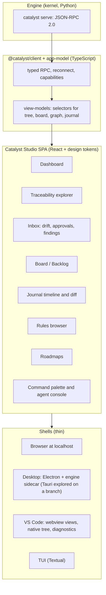

# 09 — UI, brand and portability: the decisions

Digest of `05-catalyst-ui-analysis.md` (full inventory, 30 bugs, wireframes, 25-method protocol) turned into decisions
that fit `07-ideal-architecture.md` and `06-roadmap-streamline.md` phases R5–R6.

---

## 1. Where the UI stands (facts)

| Fact | Consequence |
|---|---|
| ≈9.2k lines TS; the product lives in one 2,567-line `extension.ts` (203 `vscode.*` uses) | VS Code coupling is the portability blocker, not the React views |
| The core package has no `vscode` import but is Node-only | Needs extraction, not rewrite |
| Own TS parser/validator duplicates the kernel and **disagrees** (5 false errors on its own deployment) | Two truths → delete TS parser after parity |
| Parser hard-codes the SE module's folders/IDs/statuses though module schemas describe them | UI is not module-agnostic; second module impossible today |
| Only 5 React views; README claims more | "Richer" is mostly missing |
| UI-only entities PROP-/RUN- bypass the journal | violates Law 1 |
| Electron prototype: shell injection via pointer-file agent name, unsanitised markdown, no CSP | do not ship until fixed |
| Agent bridge = drop `@claude /cmd` text into chat, no result tracking | no run history, no token meter |
| Join flow still the pre-0.39 model | confusing states |

## 2. Target: one engine, one protocol, many shells

Decisions (answers the `05` §5.6 questions; revise if you disagree — see `10`):

| # | Decision | Reason |
|---|---|---|
| D1 | **Kernel (Python) owns parsing/validation/IDs**; TS parser kept only until golden-corpus parity, then deleted | one truth; ETD-driven; journal-aware |
| D2 | **Protocol first**: JSON Schema in the kernel repo generates Python and TS types; contract tests both sides | prevents version-constant drift (B-07…B-09 class) |
| D3 | **Module-driven rendering**: forms, board columns, state machines, relations come from `module.yaml`; no module code executed in the UI | portable + secure; second module needs no UI release |
| D4 | **Read anywhere, write through the engine**: every mutation is a CLI/engine verb (journaled) or an agent dispatch; UI never edits governed files | Law 1; kills PROP-/RUN- bypass |
| D5 | **DECIDED (owner): Electron** for the desktop shell, renderer with no Node and no shell (context isolation, sandbox, CSP). A time-boxed **Tauri spike** lives on branch `explore/tauri-shell` in the UI repo; compare on bundle size, sidecar handling, signing/auto-update and PTY need before any switch | the Electron prototype and an embedded terminal stay options; the R0 security fixes become mandatory, not optional |
| D6 | Browser mode (`catalyst serve --ui`) is the *reference* shell; VS Code and desktop embed the same bundle | portability proof = same bundle in 3 hosts |
| D7 | Agent adapters stream output and token usage (`claude -p --output-format stream-json`; others via adapters; MCP for the rest) | run history, cost meter, any agent |
| D8 | A11y and theming from day one: tokens, dark/light, status = icon + word + colour | quality bar |

## 3. A "richer" UI — prioritised

(Full 20-feature table with data sources in `05` §3.1; four wireframes in `05` §3.2.)

| Priority | Feature | Why it matters to the *goal* (clarity, fewer tokens, any agent) |
|---|---|---|
| P0 | **Dashboard** — check health, open work, drift, versions, rule coverage | "what is going on" in one screen (this very request) |
| P0 | **Inbox** — unrecorded changes (adopt/reject), findings, sign-offs, RECON | turns LLM judgment into human clicks; the CLI emits decision requests |
| P0 | **Traceability explorer** — rule ↔ work ↔ step ↔ test ↔ journal | the product's unique value |
| P0 | **Entity page** from module schema, with allowed transitions | module-agnostic editing without prompts |
| P0 | **Command palette + agent console** — every command spec'd by `catalyst spec`, dispatched to *any* agent with streamed output | agent portability made visible |
| P1 | Board/backlog, journal timeline + diff, rule browser, roadmap timeline, approvals queue, project switcher, global search | |
| P2 | Token/cost meter, analysis workspace, criterion/store sync panel, IAM admin, release center, notifications | token reduction becomes *visible* |
| P3 | Embeds (web component, README badge), PDF/HTML audit pack | adoption |

**Token-saving UI principle:** anything the UI can do deterministically (list, filter, status change, backlog) costs *zero*
agent tokens; the agent is only invoked for judgment, with a pre-assembled brief.

## 4. Portability plan (staged; matches roadmap R0 → R6)

| Stage | Scope | Exit criterion |
|---|---|---|
| 0 Hygiene (R0.11) | fix B-01/B-02 (or freeze Electron), short-ID resolution + parity test vs `catalyst check --json`, single generated kernel-range constant, live panel refresh, workspace-trust gate, drop memory-note scan, rotate leaked token | Problems panel == `catalyst check`; no known RCE |
| 1 Decouple | split `extension.ts` into ~10 files; `HostPort` abstraction (notify, pick, input, openExternal, clipboard, trust); extract `@catalyst/app-model` | no `vscode` import outside adapters |
| 2 Engine | `catalyst serve` (stdio), JSON Schemas, TS client; VS Code switches to engine (TS parser as fallback) | parity green on 3 corpora |
| 3 Studio | SPA + design tokens + P0 views; mounted in VS Code webview views and at localhost | same bundle in both hosts; axe clean |
| 4 Desktop | Electron + sidecar engine (bundled Python), hardened renderer, signing, auto-update from an org-owned feed; Tauri spike result reviewed here | installs on macOS/Windows/Linux without Node |
| 5 Ecosystem | embeds, TUI, MCP server, sandboxed module UI (iframe + postMessage + CSP + signature) | third-party module renders a panel with no host access |

Security stance for the local server: bind 127.0.0.1, random per-session bearer token in a 0600 file, reject foreign
`Origin`, only opened deployments readable, writes require workspace trust, agent dispatch needs a user-gesture token.

## 5. Brand

### 5.1 Problem

Nine overlapping names (catalyst, Catalyst framework, catalyst-ui, criterion, catalyzer, corpus, UI module, cantica-tech,
PROP/RUN) + a stock flask icon. "Catalyst" itself is crowded (Apple Mac Catalyst, Perl Catalyst, UI kits).

### 5.2 Naming architecture (proposal)

| Thing | Name | Replaces |
|---|---|---|
| Framework + CLI + spec | **Catalyst** | "catalyst framework", "kernel" in user-facing text |
| Governance data | **the Record** (`.catalyst/`) | criterion, working copy, corpus |
| Process packs | **Modules** | process module, UI module |
| Agent helpers | **Adapters** | catalyzer, plugin (for agents) |
| UI | **Catalyst Studio** | catalyst-ui, "Catalyst framework" extension |
| Wire format | **Catalyst Protocol** | — |
| Maker | Cantica Tech | visible in About/releases |

Alternatives for the UI name: *Catalyst Lens* (inspection), *Catalyst Ledger* (memory). **Before investing, run a
trademark/package-name search** (npm, PyPI, Marketplace, domain); if "Catalyst" is untenable, keep the CLI binary
`catalyst` as a command alias and rebrand the product (candidates to evaluate: names evoking *record / provenance / trace*).

### 5.3 Identity brief

* **Promise (tagline options):** "Every change, traced to a reason." · "Project memory your agents can't forget." ·
  "Verifiable memory for AI-built code." · "From rule to line — and back."
* **Visual:** deep ink indigo base, reactive amber accent (the "catalyst moment" = agent activity/CTA), semantic colours
  independent of brand (verified green, drift orange, broken red, unknown slate). Status = icon + word + colour.
* **Mark:** three linked nodes closing into a check, or a hexagon whose edges are chain links with one highlighted path;
  must work at 16 px monochrome and as app icon.
* **Type:** humanist sans UI (Inter/IBM Plex Sans) + monospace with clear 0/O, l/1 for IDs (JetBrains/IBM Plex Mono).
* **Voice:** precise, calm, evidence-first ("checked by `catalyst check` 2 min ago"); no exclamation marks.
* **Recognisable artifacts:** the `brief` output header, the `.catalyst/` folder, ID format `REQ-000042`, a signature
  "trace line" (rule → work → commit) that appears in CLI output, UI, PR comments and README badges.

### 5.4 Brand-in-the-CLI (cheap and effective)

Every CLI command ends with the same one-line footer when interactive:
`catalyst · checked 14:08 · journal ok · 0 drift` — makes the brand and the trust state visible in any agent transcript.

## 6. Work already scoped in other docs

* Security/hygiene fixes: roadmap R0.11. Engine and protocol: R5. Studio, desktop, brand: R6.
* Resolve first: UI naming and trademark check (R1.5), module-agnostic rendering depends on `module.yaml` v3 (R4.3).
